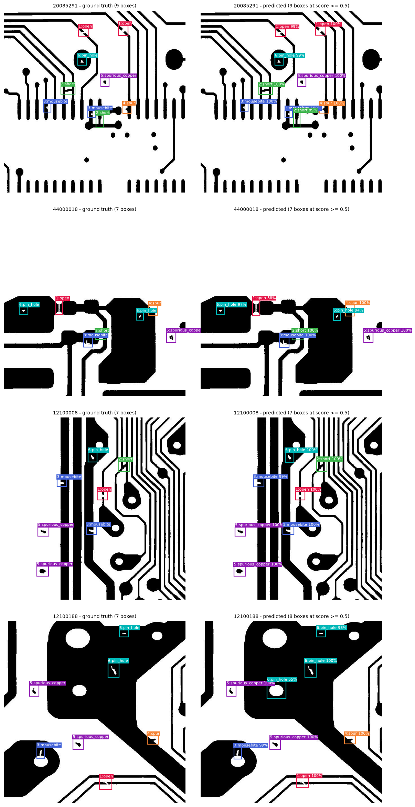
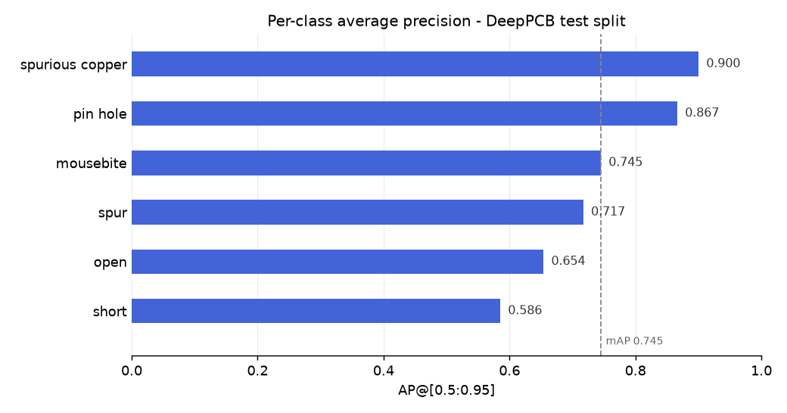

# PCB Defect Detector

Object detection model that locates and classifies manufacturing defects on printed
circuit boards. Given a board image it returns a bounding box, a defect class and a
confidence score for every defect it finds — served through a Gradio web demo.

Faster R-CNN (ResNet50-FPN, COCO-pretrained) fine-tuned on DeepPCB.
**mAP@0.5 = 0.961**, mAP@[0.5:0.95] = 0.745 on the official 500-image test set.



## Problem

Automated optical inspection of PCBs has to answer two questions at once: *is there a
defect*, and *where and what is it*. A whole-image classifier answers only the first.
This project trains a detector that outputs a box and a class per defect, across the
six defect types DeepPCB annotates: **open, short, mousebite, spur, spurious copper,
pin hole**.

The dataset is binarized 640x640 board images with 1–15 defects each. Defects are
small — mean box is roughly 39x36 px, about 0.3% of the image area — so this is a
small-object detection problem, and localization tightness, not detection, is what
limits the score.

## Dataset

DeepPCB — Tang et al., *"Online PCB Defect Detector on a New PCB Defect Dataset"*,
[arXiv:1902.06197](https://arxiv.org/abs/1902.06197),
[github.com/tangsanli5201/DeepPCB](https://github.com/tangsanli5201/DeepPCB).

1,500 image pairs (defect-free template + tested image), 640x640, with an official
1,000/500 train-test split. Only the tested images are used here; the templates are not.

Class IDs come straight from the DeepPCB README and were confirmed against all 1,500
annotation files: `1-open, 2-short, 3-mousebite, 4-spur, 5-spurious copper, 6-pin hole`.
They already reserve `0` for background, matching torchvision's convention, so no label
shift is applied. The on-disk layout has quirks: nested
`XXXXX_not/` annotation folders, a `_test` filename suffix, and space-separated fields.

**Note on the test split**: 332 of its 500 images come from board groups that appear
nowhere in training, so the headline numbers below measure generalization to unseen
board layouts, not memorization.

## Setup

```bash
# Windows (PowerShell) - always activate first; the bare `python` on PATH is
# not this project's interpreter.
.\.venv\Scripts\Activate.ps1
pip install -r requirements.txt

# Verify the GPU build installed (must print True):
python -c "import torch; print(torch.cuda.is_available(), torch.version.cuda)"
```

`requirements.txt` pulls PyTorch from the cu130 index. Installing `torch` from plain
PyPI on Windows gives a **CPU-only** build that trains ~30x slower — if the check above
prints `False None`, that is what happened.

Download DeepPCB and place its `PCBData/` folder at `data/raw/DeepPCB/PCBData/`.

## Usage

Run everything from the repo root.

```bash
python -m src.inspect_data     # sanity-check annotations, class IDs, box stats
python -m src.dataset          # verify splits, augmentation and collate_fn
python -m src.train            # train (10 epochs, ~40s/epoch on an RTX 5070 Ti)
python -m src.evaluate         # mAP on the official test set + result plots
python app/demo.py             # Gradio demo at http://127.0.0.1:7860
```

`src/config.py` holds every path and hyperparameter. `python -m src.train --help` and
`python -m src.evaluate --help` list the flags that override them.

## Results

Trained 10 epochs, SGD (lr 0.005, momentum 0.9, weight decay 0.0005), StepLR decaying
every 3 epochs, batch size 8, horizontal-flip augmentation. Training loss fell from
1.0004 to 0.2571 and val loss from 0.5767 to 0.3002, converging by epoch 5.

| Metric | Test set (500 images) |
|---|---|
| mAP@0.5 | **0.961** |
| mAP@[0.5:0.95] | 0.745 |
| mAP@0.75 | 0.891 |
| mAP@0.33 *(DeepPCB's own benchmark IoU)* | 0.965 |



| Class | AP@[0.5:0.95] | AP@0.33 |
|---|---|---|
| spurious copper | 0.900 | 0.975 |
| pin hole | 0.867 | 0.980 |
| mousebite | 0.745 | 0.985 |
| spur | 0.717 | 0.962 |
| open | 0.654 | 0.983 |
| short | 0.586 | 0.906 |

Every class clears 0.90 AP at DeepPCB's IoU>0.33 benchmark threshold, so nothing is
being *missed* systematically. The gap between that and the strict COCO average is box
tightness — consistent with `loss_box_reg` staying the largest loss component
(`results/loss_curve.png`). `short` is weakest because a solder bridge between two
traces has no single obvious extent to regress to.

## Project layout

```
src/config.py        paths, class map, hyperparameters - no path is hardcoded elsewhere
src/data_utils.py    split-list and annotation-file parsing
src/dataset.py       Dataset, augmentation, splits, collate_fn
src/model.py         Faster R-CNN with the box predictor resized to 7 classes
src/train.py         manual training loop over torchvision's loss dict
src/evaluate.py      mAP, per-class AP, prediction-vs-truth figures
src/visualize.py     shared box drawing (matplotlib for reports, PIL for the demo)
src/inspect_data.py  Phase 1 annotation sanity checks
app/demo.py          Gradio web demo
```

Neither the dataset nor the 159 MB checkpoint is committed; both are reproducible from
the commands above.
